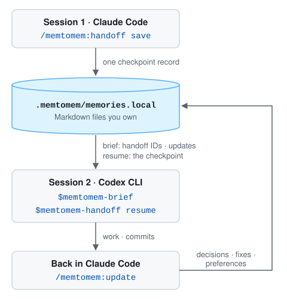

# memtomem

> Local-first long-term memory for AI coding agents: Markdown files you own, found again with hybrid keyword + semantic search. Core usage is hook-free by default: memory changes happen only when you or your agent call memtomem.

[](https://pypi.org/project/memtomem/)
[](https://pypi.org/project/memtomem/)
[](https://github.com/memtomem/memtomem/stargazers)
[](LICENSE)
[](#stability)

## Install

You need [uv](https://docs.astral.sh/uv/getting-started/installation/), which also provides the `uvx` the plugins start their server with, and the agent you add the plugin to, installed and signed in ([Claude Code](https://code.claude.com/docs/en/quickstart), [Codex CLI](https://learn.chatgpt.com/docs/codex/cli)). Install the `mm` CLI:

```bash
uv tool install --python 3.12 'memtomem[all]'
```

This and the plugin's server need a Python 3.12 that uv can find or download. If `mm` is not found afterwards, run `uv tool update-shell` and open a new shell. Then create your memory store once, as [step 2 of the plugin quickstart](docs/guides/plugin-quickstart.md#2-shared-setup-initialize-your-user-memory-store-once) shows; that step also says to skip it if you already have saved memories or memtomem settings, and what to do when uv cannot get Python 3.12.

If you registered memtomem as an MCP server by hand before, run `mm doctor --mcp-client claude` or `mm doctor --mcp-client codex` first, and [Keep manual MCP and plugin skills](docs/guides/mcp-clients.md#keep-manual-mcp-and-plugin-skills) explains the result; a manual entry and the plugin's server can otherwise both run, or the manual one can serve in its place.

Then add the plugin for the agent you use. Claude Code (user scope; for one project only, see the [plugin quickstart](docs/guides/plugin-quickstart.md#install-with-an-explicit-project-scope)):

```bash
claude plugin marketplace add memtomem/memtomem
claude plugin install memtomem@memtomem
```

Codex CLI:

```bash
codex plugin marketplace add memtomem/memtomem
codex plugin add memtomem@memtomem
```

In each project, register the memory tier the session loop writes to. Run this in the project's Git root:

```bash
mm mem init --scope project_local
```

Start a new Claude Code or Codex CLI session from that same Git root and run `/memtomem:brief` in Claude Code or `$memtomem-brief` in Codex CLI. The [plugin quickstart](docs/guides/plugin-quickstart.md) also covers a memtomem server you registered by hand before, and checking the connection. OpenCode, Kimi Code, Antigravity, and Cursor each have their own steps under [Coding agents](#coding-agents); for any other MCP client, follow the [Quick Start](#quick-start), or [let your coding agent set it up](#set-it-up-from-your-coding-agent).

## The session loop

Three plugin workflows carry a project's memory from one session to the next, and from one coding agent to another.

<p align="center">
  
</p>

Illustrative output — agent wording and results vary.

```text
# End of a session, in Claude Code
> /memtomem:handoff save codex-cli
handoff_id: 3f2a9c1e-7b4d-4e8a-9c2f-1d5e6a7b8c9d
scope: project_local · namespace: shared:retry-policy · 1 file written, 2 chunks indexed

# Next session, in Codex CLI
> $memtomem-brief
Recent updates and active handoff IDs
  - 3f2a9c1e-7b4d-4e8a-9c2f-1d5e6a7b8c9d  from claude-code → codex-cli
    load it with: $memtomem-handoff resume 3f2a9c1e-7b4d-4e8a-9c2f-1d5e6a7b8c9d
> $memtomem-handoff resume 3f2a9c1e-7b4d-4e8a-9c2f-1d5e6a7b8c9d
git_head matches the live HEAD · worktree clean · in sync with `origin` `refs/heads/main`

# After a few commits, back in Claude Code
> /memtomem:update
mode: incremental · 4 of the latest 10 commits not yet reviewed
saved 2 items · commit-derived: 1 · session-derived: 1
```

`handoff save` writes one Markdown record into the project's own `.memtomem/memories.local`; `brief` only reads; `update` saves decisions, bug fixes, and preferences as separate items. All three run only when you invoke them, and nothing runs in the background. The [Project workflows](docs/guides/project-workflows.md) guide has each one's modes, checks, and host-specific names.

## Why memtomem?

- **Your files stay yours.** Memories are plain `.md` files you can read, edit, and version. The search index is rebuilt from them, day-file namespaces included; tag edits and working state live only in the database ([what a rebuild restores](docs/guides/reference.md#what-a-rebuild-restores)).
- **Explicit by default.** Memory operations run on your CLI or MCP calls (`mm add`, `mem_add`, `mem_index`). Optional client hooks are separate, removable integrations, not a hidden runtime default.
- **One store, many tools.** Claude Code, Codex CLI, OpenCode, Kimi Code, and Antigravity share one local store, and any MCP client can search it. Hermes Agent joins the same store through its [plugin and memory provider](#agent-frameworks), and LangGraph apps get the same search pipeline over a store of their own with [`langchain-memtomem`](packages/langchain-memtomem/). [memtomem-stm](https://github.com/memtomem/memtomem-stm) is a separate, optional proxy that surfaces memories proactively.

## Private by design

The memtomem server runs on your machine, and its database and Markdown files stay there. With the defaults (BM25-only search, no LLM, no reranker) the server sends none of your note text anywhere. Some optional providers send text to an outside service, and each one is off until you configure it; a request to a loopback address can still leave your machine if your environment routes HTTP through a proxy or the local server forwards the request to a hosted model. Separately, the MCP tools return note text to the AI client that called them, and memtomem does not control what that client sends to its own model provider. [What leaves your machine](docs/guides/configuration.md#what-leaves-your-machine) lists what each setting sends, when, and where.

## Set it up from your coding agent

Paste a prompt into Claude Code, Codex CLI, or another coding agent. The agent runs the [Quick Start](#quick-start) commands for you, asks before the choices that are yours, and shows you the result.

**Install and verify:**

```text
Install memtomem on this computer by following
https://github.com/memtomem/memtomem#quick-start.
If a ~/.memtomem folder already exists, memtomem is already set up here: stop and
tell me, and change nothing.
Otherwise ask me which preset to use (minimal, english, or korean) and which folder
should hold my memories, then run `uv tool install --python 3.12 'memtomem[all]'` and
`mm init --non-interactive --preset <preset> --memory-dir <folder> --mcp skip`.
Verify with `mm add "memtomem setup check" --file setup-check.md` (pick another file
name if that one exists) and a `mm search` that finds it, and show me both outputs.
If a command fails, stop and show me the error instead of working around it.
Do not edit, move, or delete my existing notes, and do not install any hooks.
Finish by telling me which plugin under "Works with" connects this agent.
```

**Something looks wrong:**

```text
Check my memtomem setup with read-only commands: run `mm doctor` and `mm memory doctor`,
then list each finding with the command that would fix it. Ask me before you run any fix.
```

Prefer to run the commands yourself? The Quick Start below is the same path, step by step.

## Quick Start

### 1. Install

```bash
uv tool install --python 3.12 'memtomem[all]'   # or: pipx install 'memtomem[all]'
mm --version                                    # verify install
```

`--python 3.12` has uv download Python 3.12 when none is installed (by default); without it, uv can pick an older system Python and stop with `No solution found`. The flag needs a Python 3.12 that uv can find or download: where uv may not download Python on its own (`python-downloads = "never"` or `"manual"` in its configuration), a machine with only a newer Python stops with `No interpreter found for Python 3.12`. An offline uv cannot download one either: with the packages already cached, the launch still stops that way unless a Python 3.12 was installed beforehand. Then install a Python 3.12 first (`uv python install 3.12` downloads one under `"manual"`, not under `"never"`), or install with the Python you have, such as `uv tool install --python 3.13 'memtomem[all]'` with your version in place of `3.13`. `[all]` bundles ONNX dense embeddings, the Korean tokenizer, the code chunker, and the Web UI (about 340 MB installed, before any model download). The Ollama and OpenAI embedding providers need no extra. A smaller install is under [Other install options](#minimal-install) below.

### 2. Setup

```bash
mm init                               # preset picker, then memory_dir + MCP
```

The interactive picker starts with three presets — **Minimal** (BM25, no downloads), **English (Recommended)** (ONNX `multilingual-e5-small` + auto-discover providers), **Korean-optimized** (ONNX `multilingual-e5-small` + `kiwipiepy` tokenizer); no preset turns on a reranker — plus an **Advanced** entry that opens the full 10-step wizard. Preset paths only ask about the memory directory and MCP registration; everything else is set from the preset.

Choose **Minimal** for the fastest no-download first proof and rerun `mm init` later to add semantic search. For automation, `mm init --non-interactive` picks the minimal preset without prompts. See [Embeddings](docs/guides/embeddings.md) for the model and provider matrix. The presets keep embedding on your machine; choosing OpenAI embeddings, a cloud LLM, or the Cohere reranker sends note text to that service ([What leaves your machine](docs/guides/configuration.md#what-leaves-your-machine)).

<a id="3-use"></a>
### 3. Verify a complete memory round trip

```bash
mm status
mm add "Deployment checklist uses blue-green rollout" --tags ops
mm search "blue-green"
```

The last command should return the sentence you just added. `mm add` writes to your user memory directory and indexes the entry immediately, so this works without an existing notes directory or a connected editor. To bring existing notes into the same index, run `mm index /path/to/your/notes`.

### 4. Connect your coding agent

Install the plugin for your tool: the commands for Claude Code and Codex CLI are under [Install](#install), and [OpenCode](packages/opencode-memtomem/), [Kimi Code](packages/memtomem-kimi-skills/), [Antigravity](packages/memtomem-antigravity-plugin/), and [Cursor](packages/memtomem-cursor-plugin/) each have their own steps. Then, in the project you work on, register the memory tier the session loop writes to:

```bash
cd <your-project> && mm mem init --scope project_local
```

Start a new session and run the brief workflow: `/memtomem:brief` in Claude Code, and the name each other host uses is in the [Project workflows](docs/guides/project-workflows.md) guide. The [Claude Code & Codex CLI plugin quickstart](docs/guides/plugin-quickstart.md) ([한국어](docs/guides/vibe-coding-getting-started-ko.md)) walks through plugin installation and a first memory save-and-search round trip in 10–15 minutes. For Windsurf, Claude Desktop, Gemini CLI, other MCP clients, and registering Cursor by hand instead of through the plugin, see [MCP Client Setup](docs/guides/mcp-clients.md); from any client, asking it to call the `mem_status` tool confirms the connection.

<a id="4-web-ui-optional"></a>
### 5. Open the Web UI (optional)

```bash
mm web                # dashboard on http://127.0.0.1:8080
mm web -b             # run in the background; logs go to ~/.memtomem/logs/web.log
mm web stop           # stop the tracked Web UI process
```

`mm web` shows the polished page set. `mm web --dev` (or `MEMTOMEM_WEB__MODE=dev`) adds maintainer pages such as Sessions, Working Memory, and Health Report.

<details>
<summary><b>Other install options</b></summary>

<a id="minimal-install"></a>
**Minimal** (no bundled model, about 50 MB):
```bash
uv tool install --python 3.12 memtomem   # no extras — no local ONNX model, Web UI or Korean tokenizer until you add them; Ollama/OpenAI embeddings still work
```
Opt in later per feature: `uv tool install --reinstall 'memtomem[onnx,web]'` (see the [extras table](docs/guides/getting-started.md#optional-extras)). List every extra you want to keep, because `--reinstall` replaces the whole set. A plain `mm upgrade` keeps the extras it detects from the current install, but an explicit `mm upgrade --extras` list must name the complete set too.

**Project-scoped** (per-project isolation):
```bash
uv add 'memtomem[all]' && uv run mm init    # all commands need `uv run` prefix
```

**No install** (uvx on demand):
```bash
claude mcp add memtomem -s user -e MEMTOMEM_EXTRA_TOOLS=mem_update_coverage -- uvx --python 3.12 --isolated --from "memtomem[all]==0.7.13" memtomem-server
```

Like the install, this launch needs a Python 3.12 that uv can find or download ([1. Install](#1-install) says what to do where it cannot). With only a newer Python, install memtomem with that Python and register `-- memtomem-server` instead, as the [MCP clients guide](docs/guides/mcp-clients.md#1-claude-code) shows.

</details>

<details>
<summary><b>Troubleshooting the install</b></summary>

- **`mm --version` shows an older version than the [latest release](https://github.com/memtomem/memtomem/releases)** right after installing: `uv` is likely serving cached PyPI metadata. Re-run with `uv tool install 'memtomem[all]' --refresh`, or clear the cache first with `uv cache clean memtomem`. To upgrade an existing uv tool install, use `mm upgrade` rather than re-running `uv tool install`; see the [CLI reference](docs/guides/reference/data-config-cli.md#cli-reference) for what it preserves and stops.
- **`mm: command not found`**: `uv tool install` drops the shim into `~/.local/bin`, which is not on `$PATH` in fresh shells on macOS/Linux. Run `uv tool update-shell`, then open a new shell and re-run `mm --version`.
- **Duplicate tools after upgrading the Claude plugin**: re-check `/mcp` after reloading. The plugin launches `memtomem[onnx]==0.7.13`. A manual registration whose launch differs — base-only `memtomem`, or the ONNX launch pinned to an earlier release — no longer matches for deduplication. Confirm the manual entry's name and scope, then align its launch command with the plugin or remove the redundant registration.
- **Indexing vs. discovery (Claude Code)**: provider memory folders that setup auto-discovers (such as `~/.claude/projects/*/memory/`) are added to the search *index*. That is separate from the Web UI's opt-in Context Gateway scan of `~/.claude/projects/`, which discovers project *roots* for Skills, Commands, and Subagents; see [Configuration → Context Gateway](docs/guides/configuration.md#context-gateway).

</details>

## Works with

Everything here runs on the [**memtomem**](https://pypi.org/project/memtomem/) core package: the MCP server, CLI, Web UI, hybrid search, and storage. [**memtomem-stm**](https://github.com/memtomem/memtomem-stm) is a separate, optional STM proxy that surfaces memories proactively by intercepting tool calls.

| Use it from | For | Start here |
|---|---|---|
| **A coding agent** | Saving and resuming project memory across sessions and tools | [Coding agents](#coding-agents) |
| **Any MCP client** | Searching and writing the store with nine core tools | [MCP Client Setup](docs/guides/mcp-clients.md) |
| **The terminal** | Indexing, health checks, scripts (`--json` output) | [CLI reference](docs/guides/reference/data-config-cli.md#cli-reference) |
| **A browser** | Browsing sources, tags, the timeline, and duplicates (`mm web`) | [Web UI](docs/guides/reference/operations.md) |
| **Agent frameworks** | LangGraph stores and Hermes Agent memory | [Agent frameworks](#agent-frameworks) |

### Coding agents

| Package | What it adds | Session loop |
|---------|--------------|--------------|
| [**Claude Code plugin**](packages/memtomem-claude-plugin/) | Exact-pinned MCP server and slash-command workflows | handoff · brief · update |
| [**Claude Code automation plugin**](packages/memtomem-claude-automation-plugin/) | Optional hooks for prompt-time search and write-time indexing | — |
| [**Codex plugin**](plugins/memtomem/) | Exact-pinned MCP server and skills for Codex CLI | handoff · brief · update |
| [**opencode-memtomem**](packages/opencode-memtomem/) | Exact-pinned MCP server, commands, and read skills for OpenCode | handoff · brief · update |
| [**Kimi Code skills**](packages/memtomem-kimi-skills/) | Skill bundle for Kimi Code (not a plugin) | handoff · brief · update |
| [**Antigravity CLI plugin**](packages/memtomem-antigravity-plugin/) | Exact-pinned MCP server and skills for `agy` — [experimental](#stability) | handoff · brief · update |
| [**Cursor plugin**](packages/memtomem-cursor-plugin/) | Exact-pinned MCP server and skills for Cursor — [experimental](#stability) | handoff · brief · update |

### Agent frameworks

| Package | What it adds | Session loop |
|---------|--------------|--------------|
| [**langchain-memtomem**](packages/langchain-memtomem/) | A LangGraph `BaseStore`, `MemtomemPipelineStore`, whose `search(query=...)` runs memtomem's search pipeline over an index the store owns; `pip install langchain-memtomem` | — |
| [**Hermes Agent plugin**](packages/memtomem-hermes-plugin/) | Exact-pinned MCP server and the search, recall, status, remember, index, and setup skills; listed in the Hermes plugin catalog as `memtomem` | — (needs a project root) |
| [**Hermes memory provider**](packages/memtomem-hermes-memory/) | Memory provider that adds relevant notes to each Hermes turn, and can mirror Hermes's built-in memory into memtomem (`mirror_writes`, off by default); listed in the Hermes plugin catalog as `memtomem-memory` | — |

## What else is inside

| Your memory, your files | Operate it | Plug it in |
|---|---|---|
| Markdown is the source of truth; the search index is rebuilt from it (database-only state such as tag edits is not) | [Web UI](docs/guides/reference/operations.md) for search, sources, tags, timeline, and dedup (`mm web`) | Nine core MCP tools, with `mem_do` routing every other action so agents load a small tool surface |
| Hybrid search: BM25 keyword + dense vector + RRF fusion in one query | [Namespaces](docs/guides/reference/organization-maintenance.md), auto-derived from folder names and labelled from the Web UI | [Context Gateway](docs/guides/context-gateway.md): keep Skills, Commands, and Subagents in one Store and push them to your AI runtimes |
| Semantic chunking: heading-aware Markdown, AST-based Python, tree-sitter JS/TS, structure-aware JSON/YAML/TOML | [Maintenance](docs/guides/reference/organization-maintenance.md): near-duplicate detection, time-based decay, TTL expiration, auto-tagging | [Pinned Context](docs/guides/pinned-context.md): small user/project/agent Markdown blocks composed ahead of retrieved results |
| Incremental indexing: chunk-level SHA-256 diff, so only changed chunks are re-embedded | [Scheduled jobs](docs/guides/reference/automation.md) for compaction, decay, dead-link cleanup, and dedup scans | LangGraph `MemtomemBaseStore`, plus the [Hybrid Store](docs/guides/langgraph-hybrid-store.md) with SQLite persistence and BM25/dense/RRF retrieval; [`langchain-memtomem`](packages/langchain-memtomem/) runs memtomem's search pipeline as a LangGraph store |
| | [Scriptable CLI](docs/guides/reference/data-config-cli.md#cli-reference): `--json` output on status, search, recall, and the write commands; `mm warmup` pre-loads local models | [memtomem-stm](https://github.com/memtomem/memtomem-stm): optional proxy for proactive surfacing, compression, and caching |

## Stability

memtomem is beta (`0.x`). The nine core MCP tools, the `mm` CLI, and the format of your memory files and config files change only with an `Upgrading` note in the [CHANGELOG](CHANGELOG.md), and behind a deprecation window where one is possible. Other features are supported — maintained, with their changes recorded in the CHANGELOG — without that guarantee. Feedback is welcome: [Issues](https://github.com/memtomem/memtomem/issues) · [Discussions](https://github.com/memtomem/memtomem/discussions).

These are **experimental** — their behaviour, output, or format can still change or go away without an `Upgrading` note or a window, because a decision that shapes them is still open or an LLM writes what they produce:

- **Multi-agent memory** — `mem_agent_register`, `mem_agent_search`, `mem_agent_share`, and per-agent session scopes (`mem_session_start` with `agent_id`). Open decisions: [#1477](https://github.com/memtomem/memtomem/issues/1477), [#1478](https://github.com/memtomem/memtomem/issues/1478).
- **Memory export and import bundles** — `mem_export` / `mem_import` and the Web export/import. How a backup made before 0.7.0 (bundle v1–v3) that holds project memories should be restored is still open.
- **LLM-written output** — anything memtomem's configured LLM (`MEMTOMEM_LLM__ENABLED=true`) writes: LLM auto-tagging and entity extraction, `strategy="llm"` query expansion, LLM consolidation and policy summaries, session auto-summaries, source summaries (`indexing.auto_summarize`), and contextual chunk enrichment (`indexing.enrich_chunk_context`). The rule-based modes beside them are supported.
- **Claude projects scan** in the Context Gateway (`MEMTOMEM_CONTEXT_GATEWAY__EXPERIMENTAL_CLAUDE_PROJECTS_SCAN`).
- **Duplicate brief** on `mem_dedup_scan` (`MEMTOMEM_MAINTENANCE__EXPERIMENTAL_DUPLICATE_BRIEF`): the evidence lines it adds under each member of a candidate pair, and their wording.
- **Antigravity CLI plugin** ([`packages/memtomem-antigravity-plugin/`](packages/memtomem-antigravity-plugin/)).
- **Cursor plugin** ([`packages/memtomem-cursor-plugin/`](packages/memtomem-cursor-plugin/)).

## Documentation

Hosted at **[memtomem.com](https://memtomem.com)** and available as Markdown in this repo.

| Guide | Description |
|-------|-------------|
| [Getting Started](docs/guides/getting-started.md) | Install, configure, save and find your first memory |
| [Plugin quickstart](docs/guides/plugin-quickstart.md) | Save and find a memory from Claude Code or Codex CLI in 10–15 minutes |
| [한국어 바이브코딩 빠른 시작](docs/guides/vibe-coding-getting-started-ko.md) | Claude Code·Codex CLI에서 10~15분 안에 기억 저장·검색 |
| [Project workflows](docs/guides/project-workflows.md) | handoff, brief, and update: modes, checks, and names per host |
| [MCP Client Setup](docs/guides/mcp-clients.md) | Editor-specific configuration |
| [Use cases](docs/guides/use-cases.md) | Nine runnable scenarios for multi-tool developers, personal knowledge bases, and teams |
| [All guides](docs/guides/README.md) | Reference, configuration, embeddings, operations, and more, in a suggested reading order |

## Contributing

See [CONTRIBUTING.md](CONTRIBUTING.md) for setup instructions and the contributor guide. New here? Start with an issue labelled [`good first issue`](https://github.com/memtomem/memtomem/labels/good%20first%20issue).

## License

[Apache License 2.0](LICENSE). Contributions are accepted under the terms of the [Contributor License Agreement](CLA.md).
