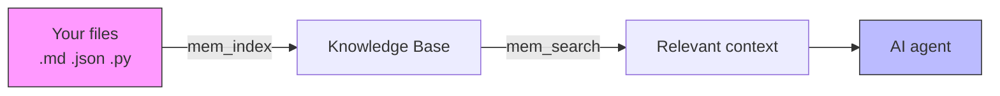
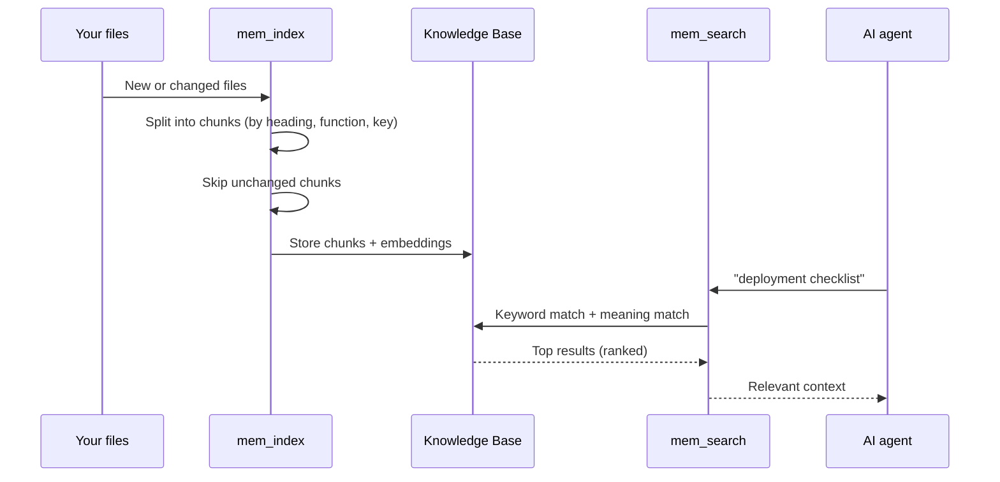

# memtomem Reference

**Audience**: Users who have completed the [Getting Started](getting-started.md) guide
**Prerequisites**: memtomem installed, MCP server connected to your AI editor

> **New to memtomem?** Start with [Getting Started](getting-started.md), or use the [Claude Code & Codex CLI plugin quickstart](plugin-quickstart.md) ([한국어](vibe-coding-getting-started-ko.md)) for a plugin-first path. This guide is a complete reference for all features.

**On this page**

- [Glossary](#glossary)
- [How memtomem Works](#how-memtomem-works)
- [MCP Tools at a Glance](#mcp-tools-at-a-glance)

**Reference pages**

- [Core memory tools](reference/core-memory-tools.md) — indexing, search, and CRUD (`mem_index`, `mem_search` / `mem_recall`, `mem_add` / `mem_edit` / `mem_delete`)
- [Organization & maintenance](reference/organization-maintenance.md) — namespaces and upkeep (`mem_ns_*`, dedup / decay / auto-tag, `mm memory doctor`)
- [Automation](reference/automation.md) — memory policies and scheduled jobs (`mem_policy_*`, `mm schedule`)
- [Data, config & CLI](reference/data-config-cli.md) — export / import / ingest, `mem_stats` / `mem_config`, the full CLI reference, moving artifacts between tiers
- [Operations](reference/operations.md) — Web UI, troubleshooting, STM proactive surfacing, uninstalling

---

## Glossary

| Term | Meaning |
|------|---------|
| **MCP** | Model Context Protocol — how your AI editor talks to memtomem |
| **Embedding** | A numeric vector that represents the meaning of text |
| **BM25** | Keyword-based search algorithm (like Google, but local) |
| **Dense search** | Meaning-based search using embeddings |
| **Hybrid search** | BM25 + dense combined — the default in memtomem |
| **RRF** | Reciprocal Rank Fusion — the algorithm that merges keyword and meaning results |
| **Chunk** | A section of a file (one heading, one function, one key) — the unit of indexing |
| **Namespace** | A label to organize memories (e.g., "work", "personal", "project-x") |
| **`mem_do`** | Meta-tool that routes to all non-core actions (with aliases). Use `mem_do(action="help")` to list all |

### The three "modes"

Three unrelated settings all use the word *mode* — they control different axes and don't interact:

| Mode | Values | What it controls |
|------|--------|------------------|
| **View toggle** (Web UI header) | Simple / Advanced | Which *tabs and sections* the Web UI shows in your browser session. Purely cosmetic — flip the **Advanced** switch in the header. |
| **Web surface** (`mm web --mode`, `MEMTOMEM_WEB__MODE`) | `prod` / `dev` | Which *pages and API endpoints* the web server exposes. `dev` adds maintainer pages (Sessions, Health Report, …) and structural namespace verbs. See [Operations → Web UI](reference/operations.md#web-ui). |
| **Tool mode** (`MEMTOMEM_TOOL_MODE`) | `core` / `standard` / `full` | How many *MCP tools* the server registers for your editor. `core` (default) exposes 9 tools and routes the rest through `mem_do`. See [Configuration](configuration.md). |

---

## How memtomem Works



**Index once, search forever.** memtomem reads your files, breaks them into meaningful chunks, and builds a searchable index. When your AI agent needs context, it searches by both keywords and meaning to find the most relevant pieces.

Your `.md` files are the source of truth for what you wrote. The search index is built from them, so deleting it and re-indexing brings back what the files hold. It does not bring back what only the database records — see below.

### What a rebuild restores

Re-indexing after the database is gone rebuilds each chunk from its file: the text, its heading,
the tags written in the file (the `> tags:` line or a frontmatter `tags:` key), and a frontmatter
validity window, and the entry's creation time from its `> created:` line, so date-ranged recall
and newest-first ordering are where they were. Chunk ids are new, so a Web UI pinned chunk saved
before the rebuild points at a chunk that no longer exists.

A memory saved outside the default namespace without naming a `file` goes to a day file of its
own, `{date}--{slug}-{digest}.md`, and a rebuild reads the namespace back from that name:
`2026-11-04--shared-my-project-<digest>.md` comes back in `shared:my-project`. Files already on
disk count, whenever they were written. The name wins over an MCP session's namespace, so
`mem_index` in a bound session rebuilds those files where they were. The index result counts them
(`namespaces_restored_from_name`).

The rest of what the database recorded is in no file, and a rebuild starts it over. That includes:

- **Namespace, for files whose name does not carry it.** `{date}.md` (the default namespace's day
  file), a file you named with `file` (unless you gave it a day file's name), and a day file whose
  name cannot be read back — the slug is truncated after 60 bytes, and characters other than `:`
  outside `A-Z a-z 0-9 . _ -` are lost — are indexed into the namespace your configuration gives their path: a namespace rule, a
  folder-based auto namespace, or else `default_namespace` (`default` out of the box). `mem_index`
  run in an MCP session with an agent or a current namespace (`mem_ns_set`) puts them into that
  namespace instead, so rebuild with `mm index` when you want the path rules. The index result
  counts the day-file names it could not read (`day_file_names_undecoded`); the other files are
  not counted.
- **Namespace moves made after writing.** `mem_ns_rename`, `mem_ns_assign` and the archive and
  promote policies change the database only. A rebuild puts those entries back in the namespace
  their day file is named for: rename `shared:old` to `shared:new`, rebuild, and they are in
  `shared:old` again.
- **Tag changes made after writing.** Auto-tagging and renaming, merging, deleting or replacing
  tags change the database only, so a rebuild returns each chunk to the tags its file holds.
- **Creation time, for text without a `> created:` line of its own.** A hand-written section
  and an entry whose header a full-replacement edit removed are dated by the re-index. An entry
  whose content opened with its own `## ` heading is not reliably dated by its entry either: the
  header is written above that heading, where it leads no section of the entry (its tags are not
  applied), and the entry keeps the header's time only when chunk merging happens to join them.
- **Working state:** access and usage counts, importance scores, links made with `mem_link`,
  summaries made by consolidation policies, sessions, schedules, and memory policies.

[Pinned Context](pinned-context.md) blocks are read from their own files, not from the index, so a
rebuild does not touch them.

To put any other file in a namespace, index it with that namespace named:

```bash
mm index --force --namespace shared:my-project path/to/file.md
```

This re-embeds the whole file and puts every chunk in it in the namespace you name, so use it on
a file that held one namespace. Indexing the file with `--namespace` before its directory has the
same result, and `--force` is not needed on that first pass. For these files you need to know the
namespace yourself.

Because a day file's name carries its namespace, a write into a file named like one must use that
namespace: writing another one into it is refused like any other namespace mix
(`allow_namespace_mix` overrides).

### What happens under the hood



---

## MCP Tools at a Glance

memtomem provides **93 MCP tools**. The table below is a curated selection
grouped by task; all 93 are listed in
[Available MCP Tools](mcp-clients.md#available-mcp-tools).

| Category | Tools | What they do |
|----------|-------|-------------|
| **Search** | `mem_search`, `mem_recall` | Find memories by meaning or by date |
| **CRUD** | `mem_add`, `mem_batch_add`, `mem_edit`, `mem_delete` | Create, update, remove memories |
| **Indexing** | `mem_index` | Build the knowledge base from files |
| **Namespace** | `mem_ns_list/set/get/assign/update/rename/delete` | Organize memories into groups |
| **Maintenance** | `mem_dedup_scan/merge`, `mem_decay_scan/expire`, `mem_auto_tag` | Keep the index clean |
| **Data** | `mem_export`, `mem_import` | Backup and restore |
| **Ask** | `mem_ask` | Natural-language Q&A over indexed memories: builds a cited prompt for the calling agent to answer, so no answer-generating LLM is required |
| **Health** | `mem_watchdog`, `mem_cleanup_orphans` | System health checks and orphan cleanup |
| **Relations** | `mem_link`, `mem_unlink`, `mem_related` | Cross-reference links between chunks |
| **Working Memory** | `mem_scratch_set/get/promote` | Ephemeral key-value scratch space |
| **Config** | `mem_stats`, `mem_status`, `mem_config`\*, `mem_embedding_reset`\*, `mem_reset`\* | Monitor and configure |
| **Pinned Context** | `mem_pinned_list/get/set/delete`, `mem_context_compose` | Keep bounded instructions ahead of retrieved memory |
| **Formation** | `mem_formation_scan`, `mem_candidate_propose/list/evidence/review/recover` | Submit and review proposed memories, weigh them against existing ones, and recover interrupted approvals |

\* Exposed as an individual tool only under `MEMTOMEM_TOOL_MODE=full`. The actions stay reachable in `core` and `standard` mode through the dispatcher — `mem_do(action="config", params={...})`, `mem_do(action="embedding_reset", params={...})`, `mem_do(action="reset", params={...})` — and the CLI equivalents are `mm config`, `mm embedding-reset`, and `mm reset`.

### `mem_do` action naming convention

In **core** tool mode (default), most features are accessed through `mem_do(action="...")`. Action names follow these conventions:

- **Namespace actions** use `ns_` prefix: `ns_list`, `ns_set`, `ns_assign`, `ns_rename`, `ns_delete`
- **Session actions** use `session_` prefix: `session_start`, `session_end`, `session_list`
- **Scratch (working memory)** uses `scratch_` prefix: `scratch_set`, `scratch_get`, `scratch_promote`
- **Maintenance** uses descriptive names: `dedup_scan`, `decay_expire`, `cleanup_orphans`
- **Analytics** uses short names: `eval`, `activity`, `timeline`, `reflect`

Use `mem_do(action="help")` to see all available actions, or `mem_do(action="help", params={"category": "sessions"})` for per-category details with parameter descriptions. Common aliases are supported (e.g. `health_report` → `eval`, `namespace_set` → `ns_set`).

`mem_do(action="version")` returns the server version, a capability map, and a secret-free `runtime_profile` (`schema_version: 1`) describing the configured retrieval runtime and locally detectable dependency availability. Collection reads configuration without initializing models or storage or running searches; it is not evidence that each retriever has returned results successfully.

The additive `runtime_profile.search` fields `rrf_k`, `rrf_weights` (BM25,
dense order), `bm25_candidates`, and `dense_candidates` expose the configured
two-leg RRF inputs (#2377). `mm status --format json` includes these fields in
its `config` object; `mem_status` and human-readable `mm status` render them
as text. Clients must check
field presence: older schema-1 profiles omit them. A version profile is a
collection-time configuration snapshot; a client or daemon holding a negotiated
profile must reconnect after changing Core configuration.

Candidate limits are configuration values, not observed counts: search uses
`max(configured_candidates, request_top_k)` for each leg. RRF adds weighted
terms without normalization. Its two-leg agreement interval is
`(max(w1,w2)/(k+1), w1/(k+C1)+w2/(k+C2)]`, and it can be empty. This describes
two unmodified positive-weight lists only, before rescue, rerank, decay or
boosts; the `rrf` label alone does not certify those assumptions. Structured
search rounds scores to four decimals, whereas compose carries raw scores.

### Context tool parameters

Two context-gateway tools are on MCP, and both only read: `mem_context_detect` reports which agent files and runtimes a project has, and `mem_context_diff` compares the canonical artifacts with each runtime's copy. (`mem_context_compose` belongs to pinned context, not the gateway.) See the [Context Gateway](context-gateway.md) guide for the Store → Push → Runtime model.

- **`detect`** takes `include="skills,agents,commands,settings"` to also list runtime skill, sub-agent and command files and each runtime's settings file, and `include_runtimes=True` to report provider-client registration.
- **`diff`** takes the same `include` (plus `settings`) and `scope="project_shared|user|project_local"` — the canonical **tier** to compare (ADR-0016 §2).

> **Context writes have no MCP tool.** `mm context init`, `generate`, `sync`, `pull`, `migrate`, `memory-migrate`, `move`, `copy`, `version` and `install`/`update`, and the projects registry (`mm context projects …`), run from the CLI, and some also from the web UI. They write agents' hook settings, skills and instruction files, in projects and in the agents' own configuration, and a consent flag an agent passes as a tool argument is not the person's consent; at the CLI the command goes through the client's own command approval instead. For the transfer verbs see [Moving artifacts between tiers and projects](reference/data-config-cli.md#moving-artifacts-between-tiers-and-projects).

---

## Next Steps

- [Plugin quickstart](plugin-quickstart.md) — Claude Code and Codex CLI plugin-first onboarding
- [한국어 바이브코딩 빠른 시작](vibe-coding-getting-started-ko.md) — Claude Code·Codex CLI plugin-first onboarding
- [Configuration](configuration.md) — All `MEMTOMEM_*` environment variables
- [Embeddings](embeddings.md) — ONNX, Ollama, OpenAI providers
- [LLM Providers](llm-providers.md) — Optional LLM features (query expansion, auto-tag, entity extraction, consolidation, source and session summaries)
- [MCP Client Setup](mcp-clients.md) — Editor-specific configuration
- [memtomem-stm](https://github.com/memtomem/memtomem-stm) — Proactive surfacing, compression, caching (separate package)
- [Package README](../../packages/memtomem/README.md) — Installation, feature overview, and documentation entry points
