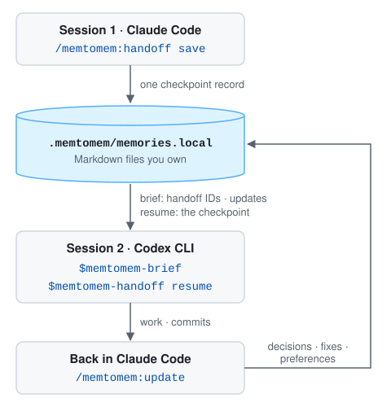

<!-- mcp-name: io.github.memtomem/memtomem -->

# memtomem

> 🧪 **Beta** — the nine core MCP tools, the `mm` CLI, and the format of your memory files and config files change only with an `Upgrading` note in the [CHANGELOG](https://github.com/memtomem/memtomem/blob/main/CHANGELOG.md), and behind a deprecation window where one is possible. Features marked **experimental** can change or go away without either — see [Stability](https://github.com/memtomem/memtomem#stability). Feedback and issue reports are especially welcome at [github.com/memtomem/memtomem/issues](https://github.com/memtomem/memtomem/issues).

Local-first long-term memory for AI coding agents: Markdown files you own, found again with hybrid keyword + semantic search. Core usage is hook-free by default: your `.md` files are the source of truth, the search index is rebuilt from them (tag edits and working state live only in the database), and memory changes happen only when you or your agent explicitly call memtomem. Optional client hooks are separate, visible integrations.

## The session loop

Three plugin workflows carry a project's memory from one session to the next, and from one coding agent to another.

<p align="center">
  
</p>

Illustrative output — agent wording and results vary.

```text
# End of a session, in Claude Code
> /memtomem:handoff save codex-cli
handoff_id: 3f2a9c1e-7b4d-4e8a-9c2f-1d5e6a7b8c9d · scope: project_local · namespace: shared:retry-policy

# Next session, in Codex CLI
> $memtomem-brief
Recent updates and active handoff IDs
  - 3f2a9c1e-7b4d-4e8a-9c2f-1d5e6a7b8c9d  from claude-code → codex-cli
> $memtomem-handoff resume 3f2a9c1e-7b4d-4e8a-9c2f-1d5e6a7b8c9d
git_head matches the live HEAD · worktree clean · in sync with `origin` `refs/heads/main`

# After a few commits, back in Claude Code
> /memtomem:update
mode: incremental · saved 2 items · commit-derived: 1 · session-derived: 1
```

`handoff save` writes one Markdown record into the project's own `.memtomem/memories.local`; `brief` only reads; `update` saves decisions, bug fixes, and preferences as separate items. All three run only when you invoke them. The [Project workflows](https://github.com/memtomem/memtomem/blob/main/docs/guides/project-workflows.md) guide has each one's modes, checks, and names per host.

## Private by design

The memtomem server runs on your machine, and its database and Markdown files stay there. With the defaults (BM25-only search, no LLM, no reranker) the server sends none of your note text anywhere. Some optional providers send text to an outside service, and each one is off until you configure it; a request to a loopback address can still leave your machine if your environment routes HTTP through a proxy or the local server forwards the request to a hosted model. Separately, the MCP tools return note text to the AI client that called them, and memtomem does not control what that client sends to its own model provider. [What leaves your machine](https://github.com/memtomem/memtomem/blob/main/docs/guides/configuration.md#what-leaves-your-machine) lists what each setting sends, when, and where.

## Set it up from your coding agent

Paste a prompt into Claude Code, Codex CLI, or another coding agent. The agent runs the [Quick Start](https://github.com/memtomem/memtomem#quick-start) commands for you, asks before the choices that are yours, and shows you the result.

**Install and verify:**

```text
Install memtomem on this computer by following
https://github.com/memtomem/memtomem#quick-start.
If a ~/.memtomem folder already exists, memtomem is already set up here: stop and
tell me, and change nothing.
Otherwise ask me which preset to use (minimal, english, or korean) and which folder
should hold my memories, then run `uv tool install --python 3.12 'memtomem[all]'` and
`mm init --non-interactive --preset <preset> --memory-dir <folder> --mcp skip`.
Verify with `mm add "memtomem setup check" --file setup-check.md` (pick another file
name if that one exists) and a `mm search` that finds it, and show me both outputs.
If a command fails, stop and show me the error instead of working around it.
Do not edit, move, or delete my existing notes, and do not install any hooks.
Finish by telling me which plugin under "Works with" connects this agent.
```

**Something looks wrong:**

```text
Check my memtomem setup with read-only commands: run `mm doctor` and `mm memory doctor`,
then list each finding with the command that would fix it. Ask me before you run any fix.
```

## Quick Start

```bash
# 1. Install memtomem with all features (Python 3.12+)
uv tool install --python 3.12 'memtomem[all]'  # or: pipx install 'memtomem[all]'
mm --version

# 2. Configure storage, search, and optional MCP registration
mm init

# 3. Verify a complete memory round trip
mm status
mm add "Deployment checklist uses blue-green rollout" --tags ops
mm search "blue-green"
```

The search should return the sentence you just added. `mm add` writes to your configured user memory directory and indexes the entry immediately, so this path works without an existing notes directory or a connected editor. Choose **Minimal** in the setup picker for a no-model-download first proof and rerun `mm init` later to add semantic search. To index existing files next, run `mm index /path/to/your/notes`.

To run the session loop, install the plugin for your coding agent ([Claude Code](https://github.com/memtomem/memtomem/tree/main/packages/memtomem-claude-plugin), [Codex CLI](https://github.com/memtomem/memtomem/tree/main/plugins/memtomem), [OpenCode](https://github.com/memtomem/memtomem/tree/main/packages/opencode-memtomem), [Kimi Code](https://github.com/memtomem/memtomem/tree/main/packages/memtomem-kimi-skills), [Antigravity](https://github.com/memtomem/memtomem/tree/main/packages/memtomem-antigravity-plugin), or [Cursor](https://github.com/memtomem/memtomem/tree/main/packages/memtomem-cursor-plugin)), then register the project memory tier with `cd <your-project> && mm mem init --scope project_local` and run the brief workflow in a new session (`/memtomem:brief` in Claude Code; the guide above lists each host's name). The [Claude Code & Codex CLI plugin quickstart](https://github.com/memtomem/memtomem/blob/main/docs/guides/plugin-quickstart.md) ([한국어](https://github.com/memtomem/memtomem/blob/main/docs/guides/vibe-coding-getting-started-ko.md)) walks through plugin installation and a first memory save-and-search round trip in 10–15 minutes; [Getting Started](https://github.com/memtomem/memtomem/blob/main/docs/guides/getting-started.md) covers install alternatives and [MCP Client Setup](https://github.com/memtomem/memtomem/blob/main/docs/guides/mcp-clients.md) covers manual registration for other editors.

`[all]` includes local ONNX embeddings, Korean tokenization, code chunking, the Web UI, Langfuse tracing, and LangGraph Store support. The Ollama and OpenAI embedding providers need no extra, so a bare `memtomem` install can use them; without a provider it searches by keyword (BM25). OpenAI embeddings, a cloud LLM, or the Cohere reranker send note text to that service; see [What leaves your machine](https://github.com/memtomem/memtomem/blob/main/docs/guides/configuration.md#what-leaves-your-machine). See the [optional extras table](https://github.com/memtomem/memtomem/blob/main/docs/guides/getting-started.md#optional-extras) for smaller bundles. If `mm` is not on PATH, run `uv tool update-shell` and open a new shell. If an install appears stale, re-run it with `--refresh`. To upgrade an existing uv tool install, run `mm upgrade` rather than `uv tool install` again: it keeps the extras it detects and, on macOS and Linux, stops running servers first (see the [CLI reference](https://github.com/memtomem/memtomem/blob/main/docs/guides/reference/data-config-cli.md#cli-reference)).

> memtomem is the long-term-memory store. [memtomem-stm](https://github.com/memtomem/memtomem-stm) is a separate, optional MCP proxy for automatic surfacing, compression, and caching.

## Works with

- **Coding agents:** plugins (a skill bundle for Kimi Code) for [Claude Code](https://github.com/memtomem/memtomem/tree/main/packages/memtomem-claude-plugin), [Codex CLI](https://github.com/memtomem/memtomem/tree/main/plugins/memtomem), [OpenCode](https://github.com/memtomem/memtomem/tree/main/packages/opencode-memtomem), [Kimi Code](https://github.com/memtomem/memtomem/tree/main/packages/memtomem-kimi-skills), [Antigravity](https://github.com/memtomem/memtomem/tree/main/packages/memtomem-antigravity-plugin), and [Cursor](https://github.com/memtomem/memtomem/tree/main/packages/memtomem-cursor-plugin) share one local store; the Antigravity and Cursor plugins are [experimental](https://github.com/memtomem/memtomem#stability).
- **LangGraph:** [`langchain-memtomem`](https://pypi.org/project/langchain-memtomem/) is a LangGraph `BaseStore` whose `search(query=...)` runs memtomem's search pipeline over an index the store owns.
- **Hermes Agent:** the [plugin](https://github.com/memtomem/memtomem/tree/main/packages/memtomem-hermes-plugin) and the [memory provider](https://github.com/memtomem/memtomem/tree/main/packages/memtomem-hermes-memory) are listed in the Hermes plugin catalog as `memtomem` and `memtomem-memory`; the provider adds relevant notes to each Hermes turn and can mirror Hermes's built-in memory into memtomem (off by default).

The [Works with](https://github.com/memtomem/memtomem#works-with) section on GitHub also covers the Claude Code automation plugin and which hosts run the session loop.

## What else is inside

| Your memory, your files | Operate it | Plug it in |
|---|---|---|
| Markdown is the source of truth; the search index is rebuilt from it (database-only state such as tag edits is not) | Web UI for search, sources, tags, timeline, and dedup (`mm web`; `--dev` adds the maintainer pages) | Nine core MCP tools, with `mem_do` routing every other action so agents load a small tool surface |
| Hybrid search: BM25 (FTS5) + dense vectors (sqlite-vec) merged by Reciprocal Rank Fusion | Namespaces, auto-derived from folder names and labelled from the Web UI | [Context Gateway](https://github.com/memtomem/memtomem/blob/main/docs/guides/context-gateway.md): keep Skills, Commands, and Subagents in one Store and push them to your AI runtimes |
| Semantic chunking: heading-aware Markdown, AST-based Python, tree-sitter JS/TS, structure-aware JSON/YAML/TOML | Maintenance: near-duplicate detection with merge, time-based decay, TTL expiration, auto-tagging | [Pinned Context](https://github.com/memtomem/memtomem/blob/main/docs/guides/pinned-context.md): small user/project/agent Markdown blocks composed ahead of retrieved memory |
| Incremental indexing: chunk-level SHA-256 diff, so only changed chunks are re-embedded | Scheduled jobs for compaction, decay, dead-link cleanup, and dedup scans | LangGraph `MemtomemBaseStore`, plus the [Hybrid Store](https://github.com/memtomem/memtomem/blob/main/docs/guides/langgraph-hybrid-store.md) with SQLite persistence and BM25/dense/RRF retrieval |
| Export and import as JSON bundles ([experimental](https://github.com/memtomem/memtomem#stability)) | Scriptable CLI: `--json` output on status, search, recall, and the write commands; `mm warmup` pre-loads local models | Multilingual by default: English, Korean, Japanese, and Chinese through the local `multilingual-e5-small` ONNX model (`bge-m3` remains available) |

The [complete MCP table](https://github.com/memtomem/memtomem/blob/main/docs/guides/mcp-clients.md#available-mcp-tools) lists every tool by category.

## Documentation

Full documentation lives in the [memtomem GitHub repo](https://github.com/memtomem/memtomem) and at [memtomem.com](https://memtomem.com):

| Guide | Topic |
|-------|-------|
| [Getting Started](https://github.com/memtomem/memtomem/blob/main/docs/guides/getting-started.md) | **Start here** — install, configure, save and find your first memory |
| [Plugin quickstart](https://github.com/memtomem/memtomem/blob/main/docs/guides/plugin-quickstart.md) | Save and find a memory from Claude Code or Codex CLI in 10–15 minutes |
| [한국어 바이브코딩 빠른 시작](https://github.com/memtomem/memtomem/blob/main/docs/guides/vibe-coding-getting-started-ko.md) | Claude Code·Codex CLI에서 10~15분 안에 기억 저장·검색 |
| [Project workflows](https://github.com/memtomem/memtomem/blob/main/docs/guides/project-workflows.md) | handoff, brief, and update: modes, checks, and names per host |
| [MCP Client Setup](https://github.com/memtomem/memtomem/blob/main/docs/guides/mcp-clients.md) | Connect Claude Code, Cursor, Codex, and other clients |
| [All guides](https://github.com/memtomem/memtomem/blob/main/docs/guides/README.md) | Reference, configuration, embeddings, operations, and more, in a suggested reading order |
| [memtomem-stm](https://github.com/memtomem/memtomem-stm) | Optional STM proxy for proactive memory surfacing (separate package) |

## License

Apache License 2.0 — see [LICENSE](https://github.com/memtomem/memtomem/blob/main/LICENSE) for details.
